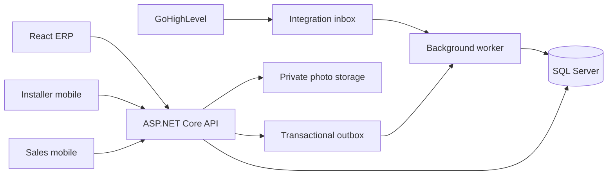

# Workflows and architecture

## Business boundaries

A party is a person or organization. A lead is a sales opportunity associated with that party, not the party itself. A customer is a durable account linked to the party. A repeat customer can have additional leads without creating duplicate accounts.

A customer has properties; a property has installed systems. A system retains its identity through repairs and upgrades. Installation and service work orders describe work performed on that system. A new installation project can exist before the system is commissioned.

Sales attribution and installer participation are many-to-many relationships. Customer-level affiliations answer who is associated with the account; order-level attribution answers who earned credit for a particular sale. Work-order assignments and compensation records answer who performed work and how much they earned or were paid.

## Main workflows

1. Import a GoHighLevel contact/opportunity into a lead, preserving external IDs and source metadata. Review possible duplicates before merging.
2. Assign one or more sales representatives, with roles and optional credit allocations.
3. Qualify, survey a property, quote products/labor, and accept an order. Record payment transactions and allocations.
4. Create or reuse the customer account in a transaction. Copy active lead representatives to customer affiliations and snapshot attribution on the order. Preserve the original lead and conversion link. Becoming a customer and becoming a paying customer are separate states.
5. Schedule an installation work order against a property/system, assign one or more installers, and record materials, labor, topology, locations, and photos.
6. Commission the system, publish its first approved topology, and create warranty coverage under the selected policy.
7. For a complaint, open a service case and work order. Show the current approved topology and component photos. Record diagnostics, replaced equipment, costs, before/after evidence, and the repair outcome.
8. Publish a new topology revision when service changes the layout. Preserve previous revisions. Accrue installer compensation and record payments separately.

Recommended default for paying customer: at least one posted, non-reversed payment allocated to an order. Deposit thresholds, settled-versus-posted status, refunds, and reporting as-of dates need a business decision. A CRM opportunity marked won must not by itself prove payment.

## Modules and ownership

- CRM: parties, leads, customer accounts, sales attribution, properties.
- Sales: quotes, orders, payments, commissions and customer payment status.
- Field operations: systems, work orders, schedules, installers, equipment usage and labor.
- Service: topology revisions, evidence, warranty coverage, service cases and diagnostics.
- Integrations: external mappings, inbox/outbox processing, retries and reconciliation.
- Administration: identity, roles, catalog, policy configuration and audit history.

The ERP owns installations, equipment, topology, repair history, and operational compensation. GoHighLevel remains the lead intake/marketing system. Choose field ownership for names, email, phone, assigned users, and pipeline stage before enabling bidirectional updates.

## GoHighLevel integration

Use supported contact and opportunity APIs plus appropriate webhook events. A CRM contact is not necessarily a lead: agree which pipeline, stage, form, or tag qualifies a contact/opportunity for import. Map GoHighLevel users explicitly to ERP staff; do not assume their IDs or assignments are interchangeable.

For one Solasta location, evaluate a private integration token; for distributed installations or multiple organizations, evaluate OAuth. Confirm event availability, scopes, account access, and authentication mode with the actual account before implementation.

Persist inbound events before acknowledging successful acceptance. Verify webhook authenticity using the documented mechanism for the selected integration. Use event identifiers where supplied, otherwise a documented deduplication fingerprint. Process asynchronously with retry/backoff, dead-letter review, and rate-limit handling. Assume duplicate and out-of-order events. Re-read current source records when necessary.

Map records by source + location ID + entity type + external ID. Email and phone are matching hints, not safe unique identifiers. Bootstrap through paginated imports and run periodic reconciliation to recover missed events. Preserve processing history and prevent outbound updates from creating synchronization loops. CRM deletion should flag review, not erase installation history.

Sources: [HighLevel API introduction](https://marketplace.gohighlevel.com/docs/intro/index.html), [authentication options](https://marketplace.gohighlevel.com/docs/), [webhook catalog](https://marketplace.gohighlevel.com/docs/category/webhook/), [contacts and duplicate matching behavior](https://marketplace.gohighlevel.com/docs/ghl/contacts/contacts/).

## Access, auditing, and reliability

Use a standard identity provider with OIDC/OAuth, MFA for privileged users, and role/assignment checks on every API operation and file download. Roles include administrator, office/dispatcher, sales representative, installer, and finance. Installers see assigned work and its necessary customer/system history; sales representatives see authorized accounts and leads. Finance access controls compensation and costs.

Keep secrets and CRM tokens server-side in secret storage. Use private files with short-lived authorized download/upload URLs. Audit conversion, attribution edits, financial adjustments, topology publication, and permission changes. Back up SQL and files together with restore exercises and agreed recovery targets.

Use database transactions and an outbox for changes that generate asynchronous work. Use optimistic concurrency to protect edits; require review for conflicting topology publication and financial changes. Archive historical records instead of cascading deletion. Decide retention and lost-device procedures before rollout.
