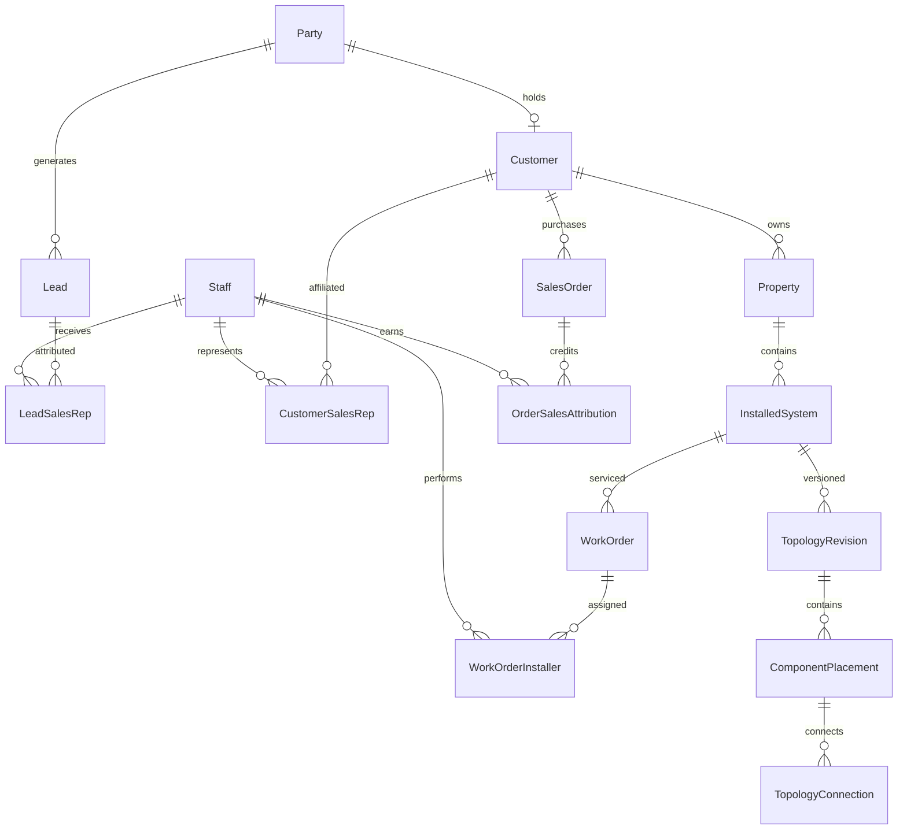

# SQL Server logical data model

This is a logical design, not executable DDL. Names and constraints should be finalized after the business decisions in the roadmap.

## Relationships

The diagram shows principal relationships; the tables below define financial, evidence, and integration details.

## CRM and people

| Entity | Key fields and purpose |
| --- | --- |
| Party | PartyId, Person/Organization type, display name; common identity across prospects/customers |
| PartyContact | PartyContactId, PartyId, kind, value, preferred flag; multiple emails/phones |
| Customer | CustomerId, PartyId unique, account number unique, status, CreatedAt |
| Staff | StaffId, display name, status; may hold both installer and sales roles |
| UserAccount / UserRole | Identity-provider subject, optional StaffId, authorized roles; staff need not have a login |
| Lead | LeadId, PartyId, source, stage, potential property, ConvertedCustomerId nullable, ConvertedAt; many leads may convert to one customer |
| LeadSalesRep | LeadId, StaffId, role, effective dates, optional allocation percentage |
| CustomerSalesRep | CustomerId, StaffId, role, effective dates, source LeadId; account affiliations |
| Property | PropertyId, CustomerId, label, normalized address, access notes, optional geolocation |

Start with one customer owning many properties. Transfers/shared ownership require an effective-dated PropertyCustomer relationship if needed; completed work must retain its original billed customer and address snapshot.

## Sales and compensation

| Entity | Key fields and purpose |
| --- | --- |
| Quote / QuoteLine | Customer or prospect, property, revision, status, quantity, price, tax, discount; accepted revision is immutable |
| SalesOrder / SalesOrderLine | CustomerId, LeadId optional, accepted quote reference, status, currency, accepted commercial snapshots |
| OrderSalesAttribution | OrderId, StaffId, role, allocation percentage, policy/version; snapshot at acceptance/conversion |
| PaymentTransaction | CustomerId, amount, currency, status, provider/external reference, posted/settled date, reversal reference |
| PaymentAllocation | PaymentTransactionId, OrderId, amount; payments may span orders and orders may receive multiple payments |
| CommissionAccrual | AttributionId, triggering payment/order, amount, policy snapshot, status; separate from payout |
| CompensationAccrual | WorkOrderInstallerId, amount, basis (hourly/fixed/piece), rate snapshot, approval status |
| StaffPayout / StaffPayoutAllocation | Payee, date, amount, external reference; allocate actual paid amounts to commission or installer accruals |

Do not put a single SalesRepId or InstallerId on Customer. Installer relationships to a customer are obtained through their work orders; optional CustomerInstaller affiliations can represent preferred technicians but must not imply work or payment.

## Installations and service

| Entity | Key fields and purpose |
| --- | --- |
| Product | ProductId, SKU unique, name, category, unit of measure, serialized flag, active flag |
| InstalledSystem | SystemId, PropertyId, name, status, commissioned date, CurrentApprovedRevisionId |
| WorkOrder | WorkOrderId, SystemId, OrderId nullable, ServiceCaseId nullable, type (install/service/upgrade), status, schedule, bill-to customer snapshot |
| WorkOrderInstaller | WorkOrderInstallerId, WorkOrderId, StaffId, role, assignment dates; unique active participation |
| LaborEntry | WorkOrderInstallerId, date/time, hours, cost rate snapshot, cost amount |
| MaterialMovement | WorkOrderId, ProductId, installed/removed/returned/consumed type, quantity, unit cost snapshot, optional asset ID; permanent costing ledger |
| ComponentAsset | AssetId, ProductId, serial/lot optional, lifecycle status; stable identity for a controller, splitter, booster, or light segment |
| AssetInstallationPeriod | AssetId, SystemId, start/end work orders and timestamps; asset history across replacement/removal |
| PhysicalLocation | LocationId, PropertyId, floor/zone/face, landmarks, access instructions, optional coordinates/image anchors |
| TopologyRevision | RevisionId, SystemId, parent revision, source WorkOrderId, Draft/Approved/Superseded, author, approved timestamps |
| ComponentPlacement | PlacementId, RevisionId, AssetId, LocationId, copied location description, diagram coordinates, configuration snapshot |
| ComponentPort | PortId, PlacementId, label, input/output role, supported connection type |
| TopologyConnection | RevisionId, from PortId, to PortId, cable type/length, routing description; physical connectivity |
| Attachment | AttachmentId, private object key, MIME type, bytes, checksum, CapturedAt, UploadedAt, author, upload state |
| PlacementPhoto / WorkOrderPhoto / ServiceCasePhoto | Explicit parent FKs + AttachmentId, caption, before/after/location category; searchable evidence without ambiguous polymorphic IDs |
| WarrantyCoverage | SystemId or AssetId, policy/version, starts/ends, scope, exclusions, original order/work order |
| ServiceCase | CustomerId, SystemId, reported symptoms, reported date, priority, status |
| WarrantyAssessment | ServiceCaseId, coverage reference, assessment date, covered/partial/not covered/pending, rationale, approver |
| RepairAction | WorkOrderId, affected AssetId, symptom, diagnostic findings, cause, action, removed/replacement assets, verification result |

Products describe catalog items; assets describe physical instances; material movements describe cost/quantity events; placements describe where assets were in a particular revision. Light segments can carry quantity/length in the asset configuration with matching units, instead of requiring an asset row for every LED.

## Integration and infrastructure tables

ExternalRecordMap (source, location, entity type, external ID, local ID); IntegrationInbox (deduplication key, payload, attempts, status); IntegrationOutbox; SyncCheckpoint; AuditEvent; MobileCommandReceipt (user/device, command ID, result); business-row concurrency tokens.

## Data invariants

- Use uniqueidentifier identifiers for entities that mobile clients create offline; use rowversion for concurrency, datetime2 UTC timestamps, and decimal for money/quantities. Define currency, unit, precision, and rounding explicitly. Never use floating point for money.
- Require FKs, indexed relationship columns, unique external mappings, unique command IDs, and checks for valid statuses/amounts. Use reversals to correct posted financial records.
- Conversion is idempotent and transactional. Preserve lead history; copy representatives with provenance and protect against duplicate affiliations. Existing customer attribution does not change silently on a new lead.
- Order attribution allocations sum to 100% when percentage-based credit is enabled. Validate this across rows transactionally; ordinary SQL CHECK constraints cannot enforce aggregate totals.
- Payment allocations cannot exceed available posted funds or reference another customer's order. Payout allocations cannot exceed approved accruals or available payout amounts. Concurrent validation must use appropriate locking/transaction isolation.
- Work orders, property, system, and customer must be consistent. Enforce cross-entity ownership in application transactions and suitable composite constraints where practical.
- A published revision is immutable, includes a full snapshot, and belongs to its system. Its parent and current-pointer references must belong to that same system. One approved current revision is selected atomically.
- Connection ports and placements must belong to the same revision. Define composite alternate keys/FKs to enforce this. Reject invalid self-connections, incompatible ports, and impossible equipment layouts according to product rules.
- Distinguish power flow from signal flow when they differ. Do not assume all installations are trees; validate against the supported hardware rather than arbitrarily forbidding every cycle.
- Every deployed asset has at most one active installation period. Use filtered uniqueness and transactional validation. Removed assets remain in history.
- Current locations can evolve; approved placements preserve the description/configuration needed to interpret old repairs. Photo evidence is append-only; corrections retain provenance.
- Require representative roles, installer roles, quantity units, and evidence rules through business validation; a job's material cost is the sum of its signed material ledger costs, not today's catalog prices.
- Archive rather than cascade-delete customers, work orders, revisions, assets, payments, or evidence. Index work-order assignments, customer/property lookups, source mappings, asset serials, and revision connections.

## Reporting

Initial reports: conversion by source/rep; paying customers by rep; revenue attribution with explicit gross/net and refund rules; equipment and labor cost by job; accrued/paid/unpaid installer compensation; margin by installation; expiring warranty; open service cases; repeated failures by SKU; systems missing mandatory photos. Separate affiliation counts from credit-weighted revenue to avoid double-counting shared sales.
